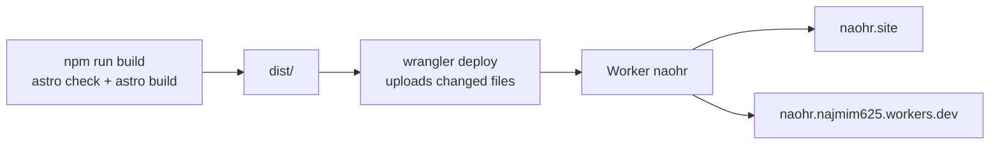

# Deployment

The site is a static Astro build served by Cloudflare as a Worker with static
assets (no Worker script). Config lives in `wrangler.jsonc`.

| | |
| --- | --- |
| Live URL | https://naohr.site |
| Preview URL | https://naohr.najmim625.workers.dev (`workers_dev: true`) |
| Worker name | `naohr` (must match `name` in `wrangler.jsonc`) |
| Cloudflare account | najmim625@gmail.com |
| Domain registrar | Hostinger (nameservers `emily.ns.cloudflare.com`, `karl.ns.cloudflare.com`) |
| Node | 22 (`.node-version`; `package.json` requires `>=22.12.0`) |



## Deploy from this machine

```bash
npm install
npx wrangler login     # once per machine; opens the browser
npm run deploy         # npm run build && wrangler deploy
```

`wrangler deploy` only uploads files whose content changed. The custom domain
(`routes` in `wrangler.jsonc`) is attached on every deploy; Cloudflare creates
its DNS record and certificate.

Check after deploying:

```bash
curl -s -o /dev/null -w "%{http_code}\n" https://naohr.site/          # 200
curl -s -o /dev/null -w "%{http_code}\n" https://naohr.site/blog/     # 200
curl -s -o /dev/null -w "%{http_code}\n" https://naohr.site/missing   # 404 (src/pages/404.astro)
```

## Auto-deploy on push to `main` (optional)

Not connected yet; until it is, pushing does **not** deploy to Cloudflare.

Cloudflare dashboard → Workers & Pages → `naohr` → Settings → **Build** →
connect GitHub repo `NAoHR/NAoHR`:

- Branch: `main`
- Build command: `npm run build`
- Deploy command: `npx wrangler deploy`

Node version is picked up from `.node-version`.

## Preview locally on the Cloudflare runtime

```bash
npm run build
npx wrangler dev        # http://localhost:8787, serves dist/ like production
```

`npm run dev` (Astro dev server) is still the normal way to work on the site.

## Rollback

```bash
npx wrangler deployments list         # recent versions with IDs
npx wrangler rollback <version-id>    # serve an older version immediately
```

Or dashboard → `naohr` → **Deployments**. A rollback does not change the repo;
the next deploy ships whatever is checked out.

## Changing the domain

Update all of: `routes` in `wrangler.jsonc`, `site` in `astro.config.mjs`
(sitemap + canonical URLs), the sitemap line in `public/robots.txt`, the JSON-LD
`url` in `src/pages/index.astro`, and the link in `README.md`. The new domain's
zone must be **Active** on the same Cloudflare account before deploying.

## Troubleshooting

- **`The package "@cloudflare/workerd-darwin-arm64" could not be found`** —
  npm skipped wrangler's platform binary (npm optional-dependency bug). Run
  `npm install` again.
- **Custom domain fails to attach on deploy** — the zone is not Active on
  Cloudflare yet (nameservers not switched/propagated). Check
  `dig NS naohr.site +short`.
- **`wrangler` asks to log in / permission errors** — `npx wrangler login`
  again; check with `npx wrangler whoami`.
